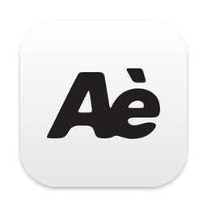
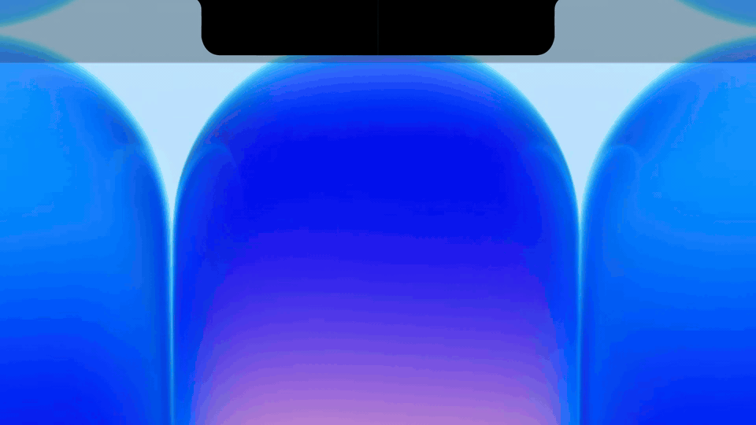

<p align="center">
  
</p>

<h1 align="center">Aède</h1>

<p align="center">
  <strong>Parle, relâche : un texte propre est collé là où se trouve ton curseur. Tout reste sur ton Mac.</strong>
</p>

<p align="center">
  
  
  
</p>

<p align="center">
  
</p>

Dictée vocale pour Mac, 100 % locale. Tu maintiens un raccourci, tu parles en français, tu relâches : un texte propre, écrit, est collé là où se trouve ton curseur. Rien n'est envoyé sur internet.

> **État : première version, en cours de validation.** Une version téléchargeable (`.dmg`, non signée) est disponible, voir [Télécharger Aède](#télécharger-aède). Tu peux aussi compiler l'app depuis les sources (voir [Installer depuis les sources](#installer-depuis-les-sources)). Le code est sous [licence MIT](LICENSE).

## Ce que fait Aède

1. **Tu maintiens un raccourci** (par défaut `Option + Espace`) et tu parles.
2. **Tu relâches.** Aède transcrit ta voix avec Whisper, puis un petit modèle de langage local nettoie le texte : il enlève les hésitations, les répétitions et les faux départs, corrige la ponctuation et l'orthographe, et met ta demande sous forme de consigne claire (à l'impératif).
3. **Le texte est collé** dans l'application active (Notes, Mail, navigateur, VS Code...) par le presse-papiers et un Cmd + V simulé. Si ton presse-papiers contenait du texte, il est remis ensuite.

Le sens ne change jamais : Aède reformule, il n'exécute pas ta demande. Si tu dictes « écris-moi un mail pour décaler la réunion », tu obtiens la consigne propre, pas le mail.

Autres points :

- **Français avec du jargon anglais.** Les termes comme `deploy`, `pull request`, `frontend` ou `dashboard` sont gardés tels quels dans la phrase.
- **Repli sur la transcription brute.** Si la reformulation échoue ou dépasse son délai (de 3 à 10 secondes selon la longueur), Aède colle la transcription brute. Un problème de reformulation ne t'empêche jamais d'obtenir du texte.
- **Indicateur visuel.** Une icône dans la barre de menus, et une petite vague dans l'encoche (ou en haut de l'écran sans encoche) qui suit ta voix, puis indique le résultat : texte reformulé collé, texte brut collé, ou erreur.
- **Historique.** Chaque texte produit est gardé dans la fenêtre avec un bouton « Copier », même si le collage a échoué. L'historique signale ce qui sort de l'ordinaire (« Texte brut », « Collage raté »).
- **Dictionnaire personnel.** Si Whisper entend toujours « super base » au lieu de « Supabase », corrige le mot à la main dans le texte collé, puis appuie sur `Option + Maj + Espace`. Aède compare le champ à ta dernière dictée et propose la paire dans la pastille de l'encoche ; refais le raccourci dans les 10 secondes pour la valider (`Échap` annule). La paire est ensuite appliquée à chaque dictée. Rien n'est jamais ajouté sans ta confirmation. La liste se gère dans la fenêtre. Voir `docs/dictionnaire.md`.
- **Semaine de test (provisoire).** Si tu actives « Garder l'audio des dictées » dans Réglages (désactivé par défaut), chaque dictée garde son enregistrement audio, que la fenêtre peut rejouer à côté de ce que Whisper a entendu. Pour ces dictées, le bouton « Signaler un problème » enregistre une note sur le disque avec la dictée concernée. Voir la section Vie privée.

## Ce qu'il faut

- Un Mac avec une puce **Apple Silicon** (M1 ou plus récent). Intel, Windows et Linux ne sont pas prévus.
- Environ **4,1 Go d'espace disque** pour les deux modèles :

  | Modèle | Rôle | Taille |
  |---|---|---|
  | Whisper `large-v3-turbo` | transcription | 1,6 Go |
  | Qwen3-4B-Instruct-2507 (Q4_K_M) | reformulation | 2,5 Go |

- Deux permissions macOS, demandées au premier lancement : **micro** (pour t'entendre) et **accessibilité** (pour simuler le Cmd + V).

## Raccourcis et réglages

| Réglage | Valeur par défaut | Où le changer |
|---|---|---|
| Dictée (maintenir pour parler) | `Option + Espace` | fenêtre principale |
| Apprendre un mot (dictionnaire) | `Option + Maj + Espace` | fenêtre principale |
| Ouverture au démarrage du Mac | désactivée | fenêtre principale |
| Garder l'audio des dictées (écoute et signalement) | désactivé | fenêtre principale, Données |
| Tout effacer (historique, enregistrements, dictionnaire) | | fenêtre, Historique |

Une combinaison avec Ctrl, Option, Maj ou Cmd est acceptée, ainsi que les touches F13 à F24 seules. Les touches F1 à F12 ne sont pas utilisables : macOS les garde pour la luminosité et le son.

## Vie privée

- **Aucune donnée ne quitte ton Mac.** La voix, la transcription et la reformulation sont traitées sur ta machine.
- **Un seul accès réseau** : le téléchargement des deux modèles depuis Hugging Face, lancé uniquement quand tu cliques sur le bouton du premier lancement. La taille et l'empreinte SHA-256 de chaque fichier sont vérifiées avant de l'utiliser. Après cela, Aède n'a plus besoin d'internet.
- **Aucune télémétrie.**
- **Lecture du texte des autres applications, limitée.** Pour le dictionnaire, Aède lit le champ de texte actif à deux moments : quand tu appuies sur le raccourci d'apprentissage, et une fois juste après chaque collage, pour retenir quelques mots autour de la dictée. Il ne surveille jamais les champs en continu. Il ne garde que ces quelques mots, en mémoire vive et 15 minutes au plus, et n'écrit sur le disque que les paires que tu confirmes.
- **L'historique, ta voix et les notes sont gardés en clair sur ton Mac**, dans `~/Library/Application Support/com.lukebanumoise.aede/` : `history.jsonl` (textes), `recordings/` (un fichier WAV par dictée quand le réglage est activé, environ 32 Ko par seconde de voix), `feedback.jsonl` (notes) et `dictionary.json` (tes paires du dictionnaire). Ces fichiers sont réservés à ton compte et ne quittent jamais la machine. Si tu dictes un mot de passe ou un message privé par erreur, il y reste jusqu'à « Tout effacer », qui supprime tout (dictionnaire compris). Rien n'est supprimé automatiquement.
- **L'enregistrement de ta voix est un réglage, désactivé par défaut.** Il sert à la semaine de test de l'auteur. Tant que le réglage est désactivé, aucun audio n'est gardé.

## Télécharger Aède

1. Télécharge le fichier `Aede_0.1.0_aarch64.dmg` depuis la [page des versions](https://github.com/moiselkbn/aede/releases/latest). Il ne fonctionne que sur un Mac **Apple Silicon**.
2. Ouvre le `.dmg` et glisse Aède dans le dossier Applications.
3. **Débloque l'app avant le premier lancement.** Aède n'est pas signé avec un compte Apple Developer, et ce n'est pas prévu : macOS le bloque donc (message « Aède est endommagé » ou « développeur non identifié »). Ce n'est pas un vrai dommage, c'est la protection de macOS contre les apps non signées. Dans le Terminal :

   ```bash
   xattr -dr com.apple.quarantine "/Applications/Aède.app"
   ```

   Sinon, ouvre l'app une fois, puis va dans Réglages Système, Confidentialité et sécurité, et clique sur « Ouvrir quand même ».
4. Lance Aède : le premier lancement te guide (permissions, téléchargement des modèles, raccourcis).

Si tu préfères ne pas faire confiance à un binaire non signé, compile l'app toi-même (section suivante). Les licences des composants embarqués sont dans [THIRD-PARTY-NOTICES.md](THIRD-PARTY-NOTICES.md), aussi copié dans l'app.

## Installer depuis les sources

**Prérequis**

- macOS sur Apple Silicon, avec les outils en ligne de commande de Xcode (`xcode-select --install`)
- [Rust](https://rustup.rs) (version récente, l'édition 2024 est utilisée)
- [Node.js](https://nodejs.org) et npm
- [CMake](https://cmake.org) (par exemple `brew install cmake`), pour compiler Whisper et llama.cpp

**Compiler et lancer**

```bash
git clone https://github.com/moiselkbn/aede.git
cd aede
npm install
```

```bash
npm run app
```

`npm run app` construit `Aède.app` (version de développement, rapide à compiler), la signe en local, puis la lance. Pour l'usage de tous les jours, construis la version optimisée avec `npm run app -- --release` : c'est elle qu'il faut utiliser pour juger la vitesse. La première compilation est longue, car elle compile aussi Whisper et llama.cpp.

**Premier lancement**

1. Accorde la permission du micro, puis celle de l'accessibilité.
2. Clique sur le bouton pour télécharger les deux modèles (environ 4,1 Go).
3. Quand l'écran affiche « Tout est prêt », place le curseur dans un champ de texte, maintiens `Option + Espace`, parle, puis relâche.

**Signature et permissions** : sans rien faire de plus, `npm run app` signe l'app de façon « ad hoc », et macOS la prend pour une nouvelle app à chaque construction : **tu dois alors redonner les permissions micro et accessibilité après chaque `npm run app`**. Pour éviter cela, crée une fois un certificat local (il ne sert que sur ton Mac) :

```bash
bash tools/create-signing-cert.sh
```

`npm run app` l'utilise ensuite tout seul, et les permissions sont gardées d'une construction à l'autre. Au premier build, macOS demande si `codesign` peut utiliser la clé : choisis « Toujours autoriser ».

Si le collage ou l'enregistrement échoue, vérifie d'abord les permissions dans Réglages Système, section Confidentialité et sécurité.

## État du projet

**Vérifié à la main**

- Le parcours complet (voix, reformulation, collage) dans Notes, Mail, un navigateur et VS Code.
- La latence : de 2,4 à 3,6 secondes après le relâchement, sur 11 dictées de 7 à 13 secondes, sur un MacBook Pro M1 Pro.
- Aucune connexion réseau pendant des dictées de test, sur une version de développement.

**Partiel**

- Les autres applications que celles citées n'ont pas été essayées : le collage peut s'y comporter autrement.
- La mesure réseau n'a pas encore été faite sur la version release.
- Le `.dmg` n'a pas encore été essayé sur un Mac qui n'a jamais eu Aède : si le déblocage ou le premier lancement coince chez toi, ouvre une issue.

**Prochain**

- Une semaine d'usage quotidien sur la version release, avec les corrections qui en sortent.
- Le réglage de l'enregistrement de la voix, désactivé par défaut, avant la première version publique.

## Limites connues

- **La reformulation n'est pas parfaite.** Sur un jeu de validation neuf, 18 phrases sur 22 sont identiques au texte attendu. Les défauts restants : un placeholder oublié (par exemple `[lien Notion]`) dans environ la moitié des cas où il faut en mettre un, une phrase d'introduction de liste parfois supprimée, et un mot mal transcrit inconnu qui n'est pas corrigé.
- **Whisper déforme parfois les termes anglais** (« Cloud » pour `Claude`, « pool » pour `pull`). La reformulation en rattrape une partie, pas tout.
- **Machine chargée = plus lent.** Avec des applications lourdes ouvertes (Illustrator, Chrome), la reformulation prend 3 à 4 fois plus de temps, et le repli sur le texte brut devient plus probable.
- **Après un lancement, les modèles se chargent pendant quelques secondes.** Une dictée faite tout de suite est collée en texte brut.
- **L'indicateur dans l'encoche repose sur des réglages non officiels de macOS.** Une mise à jour du système pourrait le casser. Le collage n'en dépend pas.

<details>
<summary><b>Pour les développeurs</b></summary>

Aède est une app [Tauri 2](https://tauri.app) : interface en React et TypeScript, cœur en Rust.

| Brique | Choix |
|---|---|
| Transcription | `whisper-rs` (whisper.cpp), accélération Metal |
| Reformulation | `llama-cpp-2` (llama.cpp), Metal, **liée en dynamique** : la lier en statique avec `whisper-rs` plante, car les deux embarquent leur propre ggml |
| Raccourci global | plugin Tauri `global-shortcut` |
| Collage | presse-papiers et touche simulée |

**Structure**

- `src/` : l'interface (fenêtre principale, premier lancement, indicateur)
- `src-tauri/src/` : un module Rust par responsabilité (`audio`, `transcription`, `rewrite`, `paste`, `shortcut`, `settings`, `history`, `recordings`, `feedback`, `dictionary`, `corrections`, `field`, `learn`, `download`, `models`, `indicator`, `tray`...)
- `tools/llm-bench/` : banc de mesure de la reformulation, avec le prompt (`prompts/v5.txt`)
- `tools/whisper-bench/` : banc de mesure de la transcription
- `tests/` : jeu de test de référence (`jargon-fr.md`) et enregistrements audio
- `docs/` : comptes rendus de chaque étape

**Vérifications**

```bash
npx tsc --noEmit && npm run build
```

```bash
cd src-tauri && cargo check && cargo clippy -- -D warnings && cargo fmt --check
```

Dans une copie neuve du dépôt (nouveau worktree), lance d'abord `cargo build -p llama-cpp-sys-2` depuis `src-tauri/` : sans cela, la compilation s'arrête sur « Library not found: target/debug/libggml.0.dylib ».

Un clone vierge n'a pas les enregistrements de test (`tests/audio/` et `tests/silence/` ne sont pas dans le dépôt). `cargo test --lib` y échoue donc sur deux tests : `dictation::tests::silent_rooms_are_below_the_threshold` et `every_recording_of_the_test_set_is_loud_enough`.

En développement, `npm run tauri dev` lance l'app, et les variables `AEDE_MODEL_PATH` (Whisper) et `AEDE_LLM_PATH` (LLM) permettent de pointer vers d'autres fichiers de modèle.

</details>

## Licence

Le code d'Aède est publié sous [licence MIT](LICENSE), copyright 2026 Moïse Lukebanu. Toute copie ou partie substantielle du code doit garder cette mention et le texte de la licence.

Les composants libres utilisés par Aède gardent leurs propres licences, rassemblées dans [THIRD-PARTY-NOTICES.md](THIRD-PARTY-NOTICES.md).

Le nom « Aède » et le logo ne sont pas couverts par la licence MIT. Si tu publies une version modifiée, donne-lui un autre nom.
